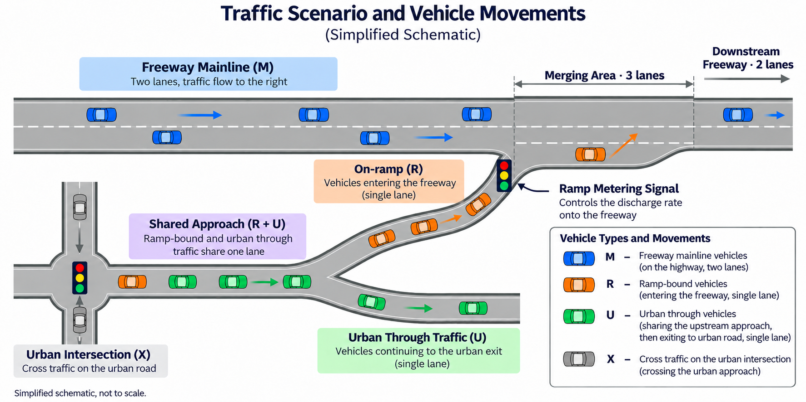

# TUB_MasterArbeit

**How does freeway ramp metering affect the freeway, the ramp and adjoining urban roads?**

This master's thesis project at Technische Universität Berlin uses SUMO, a
vehicle-level traffic simulator, to study that trade-off. Ramp metering controls
how quickly vehicles enter the freeway. It may protect mainline traffic while
moving waiting time onto the ramp and shared urban approaches.

The work uses a synthetic network: a two-lane freeway, one entrance ramp and an
upstream signalised intersection. Ramp-bound and urban-through vehicles share
part of the approach. The scene has not been calibrated against a real road.



*Conceptual layout; the simulation network is supplied in
[config/reproduction/network.net.xml](config/reproduction/network.net.xml).*

## Read the study

1. [Research progress and results](docs/development_findings.md): how demand
   exploration and model preparation led to ALINEA sensitivity tests, queue protection and a higher-rate
   candidate that did not work as intended.
2. [Data and measures](docs/data.md): the experiment index, seed-level results,
   time costs, source waiting and vehicles remaining at the simulation end.
3. [Run and reproduce](docs/reproduction.md): setup, commands and the recorded
   check of the six historical replay cases.

The development studies have identified useful comparison conditions and a
proposed control setting. The larger, paired formal comparison is still being
prepared. The [run index](results/development/run_index.csv) records completed,
interrupted and unstarted cases alongside their result locations.

See the [latest development integration status](docs/integration_status.md) for the bounded private pipeline checks and remaining formal-study decisions.

## What is available

| Material | Contents |
|---|---|
| [Development results](results/development/) | Demand comparison, 9/11/13/15% sensitivity, one QP900 case and the QP1080 negative result; selected tables and figures |
| [Historical replay data](data/exploratory_stage6/) | Six earlier OPEN/ALINEA cases, with trajectories, trips, detector records and control records |
| [Replay inputs](config/reproduction/) and [code](src/reproduction/) | The network, explicit vehicle inputs and traffic-control logic for those six cases |
| [Basic scenario](config/scenarios/minimal_uncontrolled/) | A smaller example for exploring the model and checking an installation |

In the replay sample, **V15 names a historical implementation with an 11% occupancy
target**. It is separate from the later 15% sensitivity test. The public replay
package reproduces the earlier sample; the complete later simulation controllers
and raw development outputs are not included.

## Quick start

To inspect the supplied archive without installing SUMO:

```bash
python3 scripts/verify_stage6.py --report archive_check.json
```

The report path must be new. To replay traffic, first follow the
[SUMO 1.26.0 setup and replay instructions](docs/reproduction.md). The basic example
and the six archived cases have separate entry points described there.

## License

Code, scenario input configurations and software documentation are licensed under
[MIT](LICENSE). Published outputs, summary tables and the schematic are licensed
under [CC BY 4.0](DATA_LICENSE.md). Please credit Yuhong Zhang and this repository
when reusing the material, and describe any changes you make.
