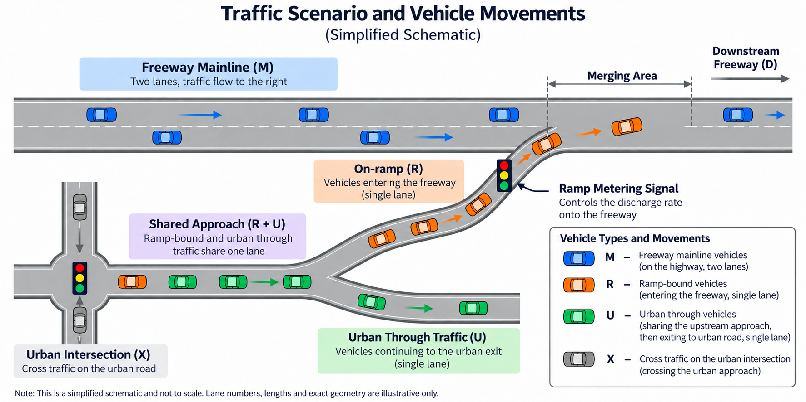

# TUB_MasterArbeit

**Studying how freeway ramp metering affects the freeway and its adjoining urban roads with SUMO.**

This repository contains selected work from a master's thesis project at Technische
Universität Berlin: a basic simulation example, six exploratory runs comparing an
uncontrolled ramp with ALINEA control, and the code and inputs needed to replay them.

The project asks whether restricting traffic at an on-ramp can relieve freeway
congestion, how much extra waiting this creates on the ramp and upstream urban
roads, and whether a control range can be found that works for both sides.

## Traffic scenario

The synthetic network consists of a two-lane freeway, an entrance ramp and an
upstream signalised urban intersection. Ramp-bound vehicles and urban through
vehicles share a single-lane approach before their routes split. A ramp queue can therefore
affect drivers who are not entering the freeway.



*Conceptual schematic, not a screenshot of the simulated network. Lane markings,
signal symbols and geometry are illustrative; the replay network is supplied in
`config/reproduction/network.net.xml`.*

The output files use four vehicle-class labels:

| Label | Vehicles |
|---|---|
| `M` | Freeway mainline traffic |
| `R` | Traffic entering the freeway via the ramp |
| `U` | Urban through traffic sharing the approach with ramp-bound vehicles |
| `X` | Cross traffic at the upstream urban intersection |

## Uncontrolled and ALINEA runs

The archived comparison uses two operating modes under matched demand:

| Mode | Ramp operation |
|---|---|
| **OPEN — no ramp metering** | The ramp signal stays green. Vehicles enter according to the road and traffic conditions. |
| **V15 — ALINEA control** | The permitted ramp release rate changes in response to downstream freeway conditions. `V15` identifies the historical implementation used for this dataset. |

The upstream urban signal timings are the same in both modes. V15 starts control
at simulation time 600 seconds and first updates its feedback at 630 seconds,
then every 30 seconds. It uses the mean occupancy of the two downstream mainline
detectors: the share of time each detector is occupied by a vehicle. Occupancy
above the target reduces the requested ramp release rate; occupancy below the
target increases it. The program translates that rate into short ramp-signal
releases with vehicle safety checks.

There are three random seeds (17, 23 and 42), each with one OPEN run and one V15
run. Each pair uses the same network, vehicle demand and vehicle attributes.

| Setting | Value |
|---|---|
| Mainline demand | 3,600 vehicles/hour |
| Ramp demand | 900 vehicles/hour |
| Urban through / cross demand | 360 / 180 vehicles/hour |
| Simulation duration | 4,200 seconds per run |

Mainline, urban-through and cross-traffic demand is scheduled from 0 to 3,000
seconds; ramp demand from 600 to 3,000 seconds. The simulation then continues
to 4,200 seconds to allow vehicles to finish their trips.

The paired results show the same trade-off in all three seeds: mainline vehicles
spend less total time in the system under V15, while ramp-bound and urban through
vehicles spend more. The combined time across all four vehicle classes also
increases. These runs illustrate the cost of protecting the mainline; they do not
establish an optimal control setting.

## Repository contents

| Path | Contents |
|---|---|
| `config/scenarios/minimal_uncontrolled/` | Road, connection, signal and detector files for the basic example |
| `src/scenarios/run_minimal_uncontrolled.py` | Builds, checks and runs the basic example |
| `src/analysis/internal_lane_accounting.py` | Trajectory and road-section accounting used by that example |
| `config/reproduction/` | Historical network and the six sets of replay inputs |
| `src/reproduction/` | Historical feedback and signal-execution logic used by the replay runner |
| `scripts/reproduce_stage6.py` | Checks inputs and replays a selected archived run |
| `scripts/verify_stage6.py` | Compares replay outputs with the archive and checks the paired table |
| `tests/` | Tests for the example and replay tools |
| `data/exploratory_stage6/` | Public copies of the six archived OPEN/V15 outputs |
| `results/paired_results.csv` | Paired summary by seed and vehicle class |

Start with [the paired table](results/paired_results.csv) for the results, or
[the data guide](docs/data.md) for field definitions. The run folders contain
vehicle trajectories, trips, queues, detector measurements and signal states.
The V15 folders also contain controller decisions and feedback records.

In the summary table, `system_seconds` is the total time from scheduled departure
to arrival for a vehicle class, including waiting to enter the network.
`source_wait_seconds` reports that entry waiting separately. Neither quantity
should be treated entirely as time spent queuing on a road.

## Run the basic example

The basic example is a smaller technical scenario for exploring the file structure
and checking a SUMO installation. Use the replay runner below to reproduce the
six archived runs.

The basic example has been checked on macOS with Python 3.13 and SUMO 1.26. It uses
the Python standard library and needs the `sumo` and `netconvert` executables.
`SUMO_HOME` must point to a SUMO installation containing `bin` and `tools`.
The basic example currently uses `/private/tmp`; other platforms have not been
tested for this entry point.

From the repository root, check the example:

```bash
python3 src/scenarios/run_minimal_uncontrolled.py --validate-only
```

This compiles the network, generates the inputs and writes a check summary without
running traffic. The terminal prints the location of `summary.json`.

To run the low-demand example:

```bash
python3 src/scenarios/run_minimal_uncontrolled.py --profile low
```

Files are written to a new `/private/tmp/minimal_uncontrolled_*` directory.

## Replay the archived runs

The replay package uses the supplied historical network and explicit vehicle
inputs, with SUMO 1.26.0 and its matching TraCI Python module. Check the package
before running a simulation:

```bash
python3 scripts/reproduce_stage6.py --check
```

For example, replay the V15 run for seed 17 into a new system temporary directory:

```bash
python3 scripts/reproduce_stage6.py --mode V15 --seed 17
```

See [the reproduction guide](docs/reproduction.md) for dependency setup, all six
commands, output comparison and the recorded verification results. Existing output
directories are never overwritten.

## Data and project status

The public archive replaces local project paths in SUMO-generated XML comments.
CSV content is unchanged. Sources, transformations, checksums and omitted files
are recorded in [the data manifest](data/exploratory_stage6/MANIFEST.json).
Input and code provenance is recorded separately in
[the replay manifest](config/reproduction/PROVENANCE.json).

These are exploratory runs at one demand setting. Seed 17 was also used during
controller development. The synthetic scene has not been calibrated against
real-road observations, and formal experiments are still being prepared.
Reproducing these outputs does not expand the scope of the original findings.

## License

Code, scenario input configurations and software documentation are licensed under
[MIT](LICENSE). The published outputs, summary tables and schematic are licensed
under [CC BY 4.0](DATA_LICENSE.md). Please credit Yuhong Zhang and this repository
when reusing the data, and describe any changes you make.
