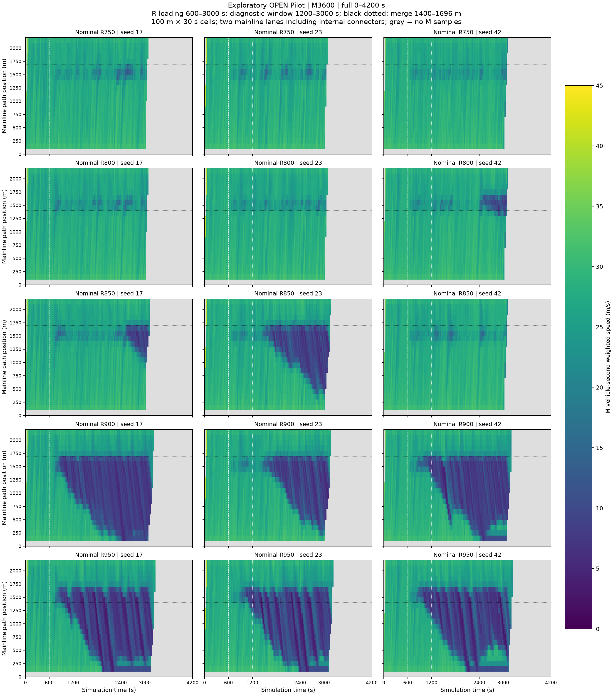
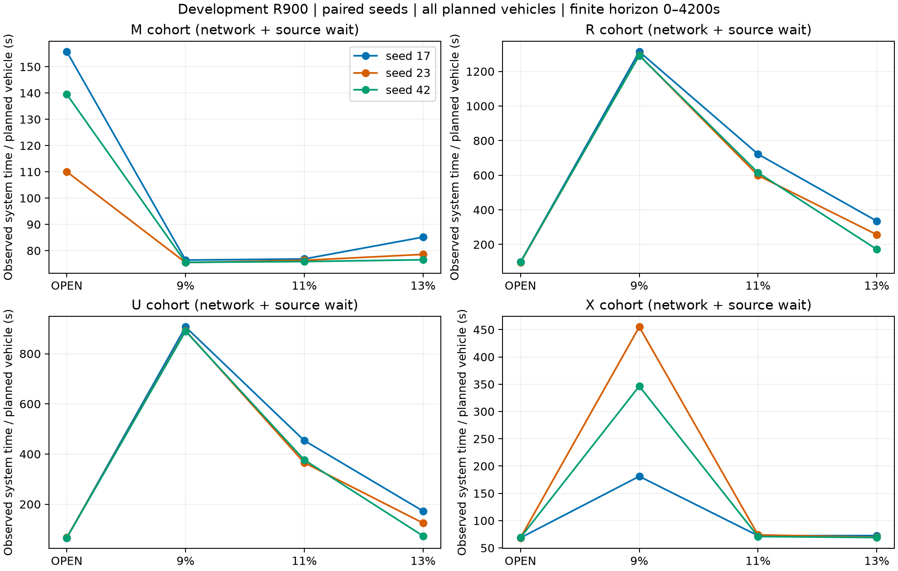
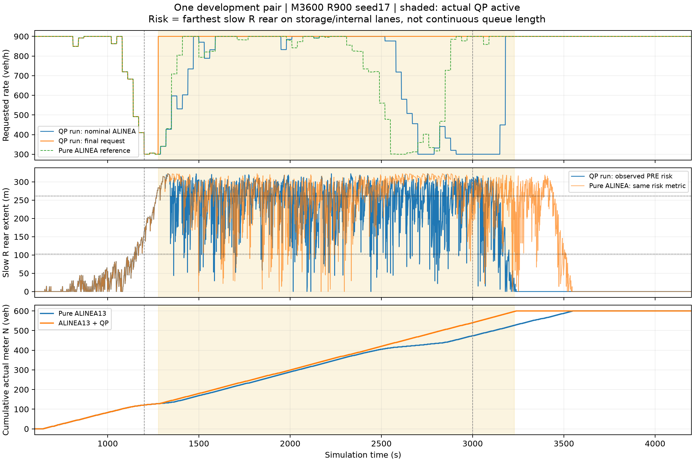

# Selected development findings

These selected records extend the existing six-run Stage6 sample. They are development evidence from one synthetic network, not formal thesis experiments or an estimate of a global optimum. No new simulations or recomputation were performed for this publication.

**Naming:** the existing sample's `V15` is a historical implementation label. It does not mean the later target-occupancy 15% experiment. The later ALINEA target sensitivity compares 9%, 11%, 13% and 15% at M3600/R900; the archived network/controller versions differ from the earlier sample. Do not pool the two datasets as interchangeable replications.

## Demand location

Nine new OPEN runs at R800/R850/R950 and seeds17/23/42 were examined alongside six historical endpoints; R700 was subsequently checked as a lighter reference. The transition varies with seed and is not a deterministic congestion threshold. The candidate formal demand set is R700/800/850/900; it remains Proposed.

## ALINEA target sensitivity

The 9/11/13% comparison and final three 15% runs used paired seeds17/23/42. Compatible Run10 supplies the historical 11% seed17 comparator; interrupted attempts are not extra complete replications. At this demand point, 13% is a Proposed balanced reference, not an approved or globally optimal target. The final 15% check did not consistently reduce total costs relative to13%, and mainline costs increased in each of the three pairs. Adverse results and original accuracy failures remain part of the underlying record.

The displayed figure covers the earlier sensitivity stage; the CSV also identifies the later 15% comparisons. Do not infer 15% results from the figure. Time costs in the selected tables follow their named source metrics; units and denominators must not be mixed. The cost comparison covers all planned vehicles over [0,4200) and includes in-network time plus source waiting. The 9% cases retain terminal residual vehicles, so these finite-horizon costs are not complete-trip mean travel times for every vehicle.

## Queue protection: one QP900 case

One M3600/R900,13%,seed17 natural paired test demonstrated activation and changed actual discharge. This supports the mechanism and this particular comparison. Its queue protection ended after planned loading stopped; it does not demonstrate queue reduction under sustained900veh/h actual arrivals. It does not establish general safety or discharge capacity.

## QP1080 negative result

The fixed candidate requested three vehicles per10-second cycle, with up to5seconds green,3seconds yellow and at least2seconds red. In the single natural validation,234 complete candidate cycles each served only two vehicles:720veh/h, rather than the nominal1080. During the protection/loading window, actual insertions exceeded meter departures, and the release-risk threshold was not reached before planned loading ended. The third vehicle never passed; third-vehicle passage and its yellow transition safety were not validated. The candidate is retained as a negative result and is not a recommended formal controller.

## Tables, provenance and reproduction boundary

Four small CSVs in `results/development/` select existing reviewed table rows/columns. `source_table` retains the original relative source location; identifiers/metrics retain the original meaning. They contain no raw trajectories, personal paths, private correspondence, Drive links or credentials. These selections are not a new analysis. Figures are unchanged copies of reviewed figures; large raw outputs are not distributed with this addition.

Historical report snapshots for these stages were respectively `a8113301678aa4143eaad377231b279bfb64b8a2` (Pilot), `c28e191374f1f70d5760f30815786ba9a66a2fd9` (R700 and9/11/13%), `add718edcf2635e75279e215c22356e30d2eadcc` (QP900), `402659bd1467354ece508237a878b86fa0f3039d` (QP1080), and `ac230f54c51bb5e630b7ce825b14f4f0230230c6` (15%). These are report-source identifiers, not claims of executable versions for every run; their full private working history is not part of this public release.

For a runnable sample use the existing [reproduction guide](reproduction.md), which applies to the earlier Stage6 dataset only. The new development selections are not packaged as another fully replayable controller release. The candidate120-run formal matrix and13% target remain Proposed; the formal protocol has not been frozen and formal experiments have not begun in this archived stage. Failed, interrupted and negative outcomes have not been upgraded by publishing these summaries.
